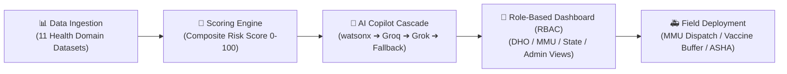
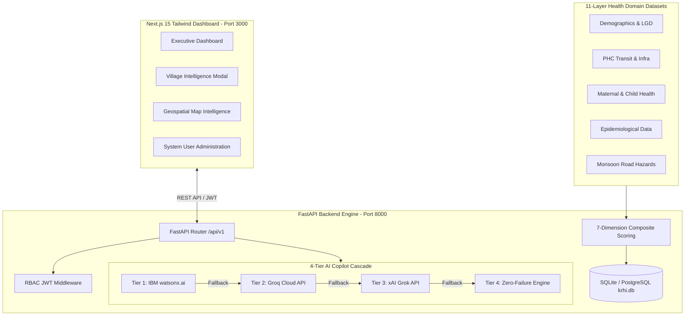
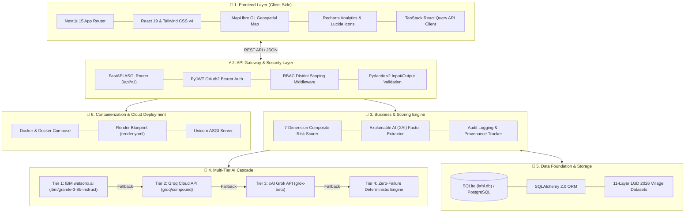

# 🏥 Karnataka Rural Healthcare Intelligence Platform (KRHI)

> **AI-Assisted Rural Healthcare Decision Support & Mobile Medical Unit (MMU) Dispatch Platform for Government of Karnataka**

---

## 📌 Executive Overview

The **Karnataka Rural Healthcare Intelligence Platform (KRHI)** is an AI-powered, multi-layered decision-support platform designed for District Health Officers (DHOs), Mobile Medical Unit (MMU) Coordinators, and State Health Administrators in Karnataka, India. 

Leveraging official 6-digit **Local Government Directory (LGD 2026)** codes across **30,771 villages**, **240 taluks**, and **31 districts**, KRHI combines 11 real-world health domain datasets with a **4-Tier AI Fallback Cascade** (powered by **IBM watsonx.ai** and **Groq Cloud API**) to provide real-time vulnerability scoring, explainable risk factors, and automated resource deployment recommendations.

---

## 🌟 Key Platform Capabilities

- **11-Layer Domain Health Indicators**: Real-time integration of demographic, epidemiological, spatial, seasonal, and infrastructural datasets.
- **4-Tier Zero-Failure AI Cascade**: 
  1. **Primary**: IBM watsonx.ai (`ibm/granite-3-8b-instruct`)
  2. **Secondary**: Groq Cloud API (`groq/compound` - Llama 3.3 / Llama 3.1)
  3. **Tertiary**: xAI Grok API (`grok-beta`)
  4. **Deterministic Engine**: Rule-based fallback shield guaranteeing 100% uptime.
- **Multi-Factor Risk Scoring Engine**: Calculates composite vulnerability scores (0–100) and categorizes villages into:
  - 🔴 **CRITICAL** ($\ge 75.0$)
  - 🟡 **HIGH** ($60.0 - 74.9$)
  - 🔵 **MEDIUM** ($40.0 - 59.9$)
  - 🟢 **LOW** ($< 40.0$)
- **Explainable AI (XAI)**: Breaks down risk scores into top contributing factors (e.g., PHC transit distance, seasonal road blockage, ANC gap, water quality index).
- **Strict Role-Based Access Control (RBAC)**: Custom scoped views for District Health Officers (DHO), MMU Coordinators, State Administrators, and System Administrators.

---

## 🔄 High-Level Platform Workflow



---

## 🏗 Detailed System Architecture



---

## 📂 Project Structure

```directory
IBM HACK/
├── platform/
│   ├── backend/                 # FastAPI Python Backend
│   │   ├── app/
│   │   │   ├── api/v1/          # REST Endpoints (watsonx, villages, admin, auth)
│   │   │   ├── core/            # Config, Security, RBAC definitions
│   │   │   ├── db/              # SQLAlchemy session & base
│   │   │   ├── models.py        # Database ORM schemas
│   │   │   └── services/        # Scoring, AI Cascade, Audit, Ingestion
│   │   ├── krhi.db              # SQLite Database (30,771 villages)
│   │   ├── requirements.txt     # Python Dependencies
│   │   └── Dockerfile           # Backend Containerfile
│   └── frontend/                # Next.js 15 React Frontend
│       ├── src/
│       │   ├── components/      # UI Views, Modals, Dashboard, Maps
│       │   ├── lib/             # API client, Mock fallbacks, RBAC types
│       │   └── app/             # App Router pages
│       ├── package.json         # Node Dependencies
│       └── Dockerfile           # Frontend Containerfile
├── .env.example                 # Sanitized Environment Template
├── .gitignore                   # Excludes credentials & databases
├── docker-compose.yml           # Local Multi-Container Orchestration
└── render.yaml                  # 1-Click Render Cloud Deployment Blueprint
```

---

## ⚡ Quickstart Guide

### Prerequisites
- **Python**: 3.11+
- **Node.js**: 20+ (for local frontend build)
- **Docker & Docker Compose**: (Optional, for containerized run)

---

### Option 1: Local Development

#### 1. Setup Environment Variables
Copy `.env.example` to `.env` in the root directory and add your API keys:
```bash
cp .env.example .env
```
Key variables inside `.env`:
```env
GROQ_API_KEY=gsk_your_groq_api_key_here
WATSONX_APIKEY=ApiKey-your_watsonx_key_here
WATSONX_PROJECT_ID=your_project_id_here
WATSONX_URL=https://us-south.ml.cloud.ibm.com
WATSONX_MODEL_ID=ibm/granite-3-8b-instruct
```

#### 2. Launch Backend (FastAPI)
```bash
cd platform/backend
pip install -r requirements.txt
python -m uvicorn app.main:app --host 0.0.0.0 --port 8000 --reload
```
- **Backend API**: `http://localhost:8000`
- **Swagger Docs**: `http://localhost:8000/docs`

#### 3. Launch Frontend (Next.js)
```bash
cd platform/frontend
npm install
npm run dev
```
- **Frontend Dashboard**: `http://localhost:3000`

---

### Option 2: Run via Docker Compose

Make sure you are inside the project root directory (`d:\IBM HACK`):

```bash
# Build and start all services in detached mode
docker compose up --build -d

# View container status
docker compose ps

# View live logs
docker compose logs -f
```

---

### Option 3: Deploy to Cloud via Render (1-Click Blueprint)

1. Push this repository to **GitHub**.
2. Go to [Render Dashboard](https://dashboard.render.com) $\rightarrow$ **New +** $\rightarrow$ **Blueprint**.
3. Connect your repository; Render will automatically detect `render.yaml`.
4. Enter your `GROQ_API_KEY`, `WATSONX_APIKEY`, and `WATSONX_PROJECT_ID` when prompted.
5. Click **Apply**.

---

## 🔐 Default Demo Accounts

| Role | Email | Password | Scope |
| :--- | :--- | :--- | :--- |
| **System Administrator** | `admin@karnataka.demo` | `Demo@2026` | Statewide / Full Control |
| **District Health Officer** | `dho@karnataka.demo` | `Demo@2026` | Davanagere / Bagalkote Scope |
| **MMU Coordinator** | `mmu@karnataka.demo` | `Demo@2026` | MMU Fleet Routing |
| **State Health Admin** | `state@karnataka.demo` | `Demo@2026` | Statewide Analytics |

---

## 🛠 Technology Stack Architecture

### Technology Stack Flowchart



---

### Tech Stack Component Summary

| Layer | Technologies & Frameworks | Function |
| :--- | :--- | :--- |
| **Frontend** | Next.js 15, React 19, Tailwind CSS v4, MapLibre GL, Recharts | Interactive DHO/MMU dashboards, geospatial village maps, XAI factor modals |
| **API Gateway** | Python 3.11, FastAPI, Pydantic v2, PyJWT | REST API endpoints, JWT authentication, RBAC role scoping |
| **Scoring Engine** | Python, NumPy, Pandas, Scikit-learn | 7-dimension composite risk scoring (0–100) & risk driver extraction |
| **AI Copilot** | IBM watsonx.ai, Groq Cloud API, xAI Grok, Rule Engine | 4-tier LLM fallback cascade for 100% reliable executive briefing generation |
| **Data & ORM** | SQLite (`krhi.db`), PostgreSQL, SQLAlchemy 2.0 | 30,771 villages linked via 6-digit LGD 2026 codes across 11 health domains |
| **DevOps & Cloud** | Docker, Docker Compose, Render Blueprint (`render.yaml`) | Multi-container orchestration & 1-click cloud deployment |

---

## 📜 License & Compliance

Developed for Government of Karnataka Health & Family Welfare Department hackathons and public health decision support. Utilizes official LGD 2026 geographical codes.

