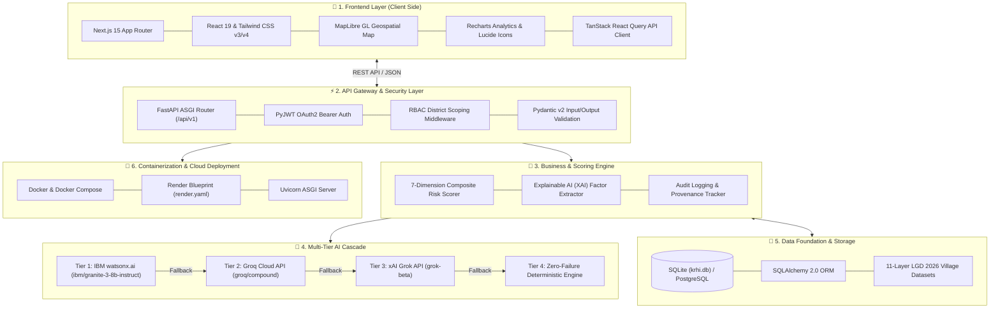

# 🏥 Karnataka Rural Healthcare Intelligence Platform (KRHI)
## Complete Technical & Architectural Documentation

> **Platform Name**: Karnataka Rural Healthcare Intelligence (RuralPulse)  
> **Target Jurisdiction**: Government of Karnataka — Health & Family Welfare Department  
> **Standardization**: Local Government Directory (LGD) 2026  
> **Coverage**: 30,771 Villages • 240 Taluks • 31 Districts  
> **GitHub Repository**: [`https://github.com/sinchana-urs/ruralpulse.git`](https://github.com/sinchana-urs/ruralpulse.git)

---

## 📋 Table of Contents
1. [Executive Summary](#1-executive-summary)
2. [Key Capabilities & Value Proposition](#2-key-capabilities--value-proposition)
3. [Technology Stack Architecture](#3-technology-stack-architecture)
4. [11-Layer Health Domain Datasets](#4-11-layer-health-domain-datasets)
5. [7-Dimension Vulnerability Scoring Engine](#5-7-dimension-vulnerability-scoring-engine)
6. [4-Tier Zero-Failure AI Cascade](#6-4-tier-zero-failure-ai-cascade)
7. [Role-Based Access Control (RBAC) & Security](#7-role-based-access-control-rbac--security)
8. [Frontend UI/UX Architecture](#8-frontend-uiux-architecture)
9. [Database Schema & Ingestion Pipeline](#9-database-schema--ingestion-pipeline)
10. [Local Development & Cloud Deployment Guide](#10-local-development--cloud-deployment-guide)

---

## 1. Executive Summary

Rural healthcare delivery in Karnataka faces structural challenges, including geographical transit barriers to Primary Health Centres (PHCs), seasonal road blockages during monsoon flooding, gaps in maternal Antenatal Care (ANC) tracking, and unequal Mobile Medical Unit (MMU) fleet distribution.

The **Karnataka Rural Healthcare Intelligence Platform (KRHI)** provides an AI-assisted, multi-layered decision support system engineered for:
- **District Health Officers (DHOs)**: To identify critical vulnerability hotspots and prioritize PHC resource allocation.
- **MMU Fleet Coordinators**: To dynamically route mobile health units to isolated and flood-prone villages.
- **State Health Administrators**: To monitor state-wide health indicators and track DVDMS vaccine buffer stocks.
- **System Administrators**: To provision accounts with strict district-level scoping.

KRHI standardizes data across **30,771 villages** in Karnataka using official 6-digit LGD 2026 codes and combines deterministic algorithms with a **4-Tier LLM Fallback Cascade** (IBM watsonx.ai, Groq Cloud, xAI Grok, and a Rule Engine) to guarantee 100% operational uptime.

---

## 2. Key Capabilities & Value Proposition

- 📍 **30,771 Village Coverage**: Comprehensive ingestion of every habited village in Karnataka indexed under official LGD 2026 codes.
- 🧮 **Explainable Risk Scoring (0–100)**: Multi-factor composite risk index categorizing villages into 4 clear alert tiers:
  - 🔴 **CRITICAL** ($\ge 75.0$): Immediate MMU fleet dispatch & emergency drug replenishment required.
  - 🟡 **HIGH** ($60.0 - 74.9$): Priority ASHA worker visit & weekly PHC outreach.
  - 🔵 **MEDIUM** ($40.0 - 59.9$): Routine health monitoring & bi-weekly checkups.
  - 🟢 **LOW** ($< 40.0$): Baseline healthcare coverage.
- 🤖 **4-Tier AI Cascade**: Zero-failure executive briefing generation combining IBM Granite models on watsonx.ai with Groq Llama 3.3 and deterministic fallbacks.
- 🗺️ **Geospatial Map Intelligence**: Interactive MapLibre GL visualization rendering color-coded risk markers, zoom/coordinate controls, and PHC transit radius overlays.
- 🔐 **Strict RBAC & Scoping**: District-level scope boundaries ensuring DHOs only access data within their assigned jurisdiction.

---

## 3. Technology Stack Architecture

### Technology Stack Flowchart



---

### Tech Stack Component Summary

| Layer | Technologies & Frameworks | Function |
| :--- | :--- | :--- |
| **Frontend** | Next.js 15, React 19, Tailwind CSS, MapLibre GL, Recharts | Interactive DHO/MMU dashboards, geospatial village maps, XAI factor modals |
| **API Gateway** | Python 3.11, FastAPI, Pydantic v2, PyJWT | REST API endpoints, JWT authentication, RBAC role scoping |
| **Scoring Engine** | Python, NumPy, Pandas, Scikit-learn | 7-dimension composite risk scoring (0–100) & risk driver extraction |
| **AI Copilot** | IBM watsonx.ai, Groq Cloud API, xAI Grok, Rule Engine | 4-tier LLM fallback cascade for 100% reliable executive briefing generation |
| **Data & ORM** | SQLite (`krhi.db`), PostgreSQL, SQLAlchemy 2.0 | 30,771 villages linked via 6-digit LGD 2026 codes across 11 health domains |
| **DevOps & Cloud** | Docker, Docker Compose, Render Blueprint (`render.yaml`) | Multi-container orchestration & 1-click cloud deployment |

---

## 4. 11-Layer Health Domain Datasets

KRHI integrates 11 core data domains, each normalized to the LGD 2026 geographical hierarchy:

| Layer Code | Dataset Name | Records | Description | Key Attributes |
| :--- | :--- | :---: | :--- | :--- |
| `LAYER_01` | **LGD Administrative Master** | 30,771 | Official census geographical mapping | Village Code, Sub-District (Taluk) Code, District Code |
| `LAYER_02` | **Village Demographics & Infra** | 30,771 | Population metrics and rural infrastructure | Population, Household Count, Water Quality Index |
| `LAYER_03` | **Health Facility Master** | 721 | Spatial registry of PHCs, CHCs, and Sub-Centres | Facility ID, Latitude, Longitude, Bed Count, Doctor Ratio |
| `LAYER_04` | **Health Service Utilization** | 721 | Outpatient, inpatient, and emergency load logs | OPD Visits/Month, IPD Admissions, Ambulance Calls |
| `LAYER_05` | **Health Indicators & Epidemiological** | 32 | District-level maternal & child health metrics | Maternal Mortality Ratio (MMR), Infant Mortality Ratio (IMR) |
| `LAYER_06` | **Anganwadi Nutrition Data** | 481 | Severe Acute Malnutrition (SAM) & Stunting logs | SAM Child Count, Moderate Acute Malnutrition (MAM) Count |
| `LAYER_07` | **Weather Hazard & Monsoon Risk** | 32 | Real-time weather hazard & rainfall indicators | Monsoon Flood Risk Level, Rainfall Anomaly Index |
| `LAYER_08` | **Village Accessibility Matrix** | 30,771 | PHC distance & seasonal road condition matrix | Distance to PHC (km), Travel Time (min), Road Type |
| `LAYER_09` | **Operational Resources (DVDMS)** | 21 | Cold-chain vaccine & drug buffer stock | Vaccine Buffer Stock Status, Essential Drug Index |
| `LAYER_10` | **MMU Operations Log** | 11 | Mobile Medical Unit fleet deployment logs | Vehicle ID, Last Visit Date, Next Scheduled Route |
| `LAYER_11` | **Health Data Availability Matrix** | 11 | Data completeness & source sync timestamps | Ingestion Timestamp, Completeness Score (%) |

---

## 5. 7-Dimension Vulnerability Scoring Engine

The risk engine computes a composite vulnerability score ($V_{score} \in [0, 100]$) for each village using weighted multi-criteria decision analysis:

$$\text{Vulnerability Score} = \sum_{i=1}^{7} (w_i \times S_i)$$

### Dimension Weights & Formulas:

1. **PHC Transit Distance ($w_1 = 0.25$)**:
   $$S_1 = \min\left(100, \frac{\text{Distance to PHC (km)}}{25} \times 100\right)$$
2. **Road Accessibility & Seasonal Washout ($w_2 = 0.20$)**:
   - `SEASONAL_UNPAVED`: 100.0 pts
   - `UNPAVED`: 70.0 pts
   - `ALL_WEATHER`: 20.0 pts
3. **Maternal ANC Coverage Deficit ($w_3 = 0.15$)**:
   $$S_3 = (100 - \text{ANC Checkup Rate \%})$$
4. **Monsoon Flood Hazard Level ($w_4 = 0.15$)**:
   - `HIGH`: 100.0 pts
   - `MEDIUM`: 50.0 pts
   - `LOW`: 10.0 pts
5. **Water Quality Deficit Index ($w_5 = 0.10$)**:
   $$S_5 = (100 - \text{Water Quality Index})$$
6. **Infant Immunization Deficit ($w_6 = 0.10$)**:
   $$S_6 = (100 - \text{Full Immunization Rate \%})$$
7. **Isolation / Population Density ($w_7 = 0.05$)**:
   $$S_7 = \min\left(100, \frac{5000}{\text{Population}} \times 20\right)$$

---

## 6. 4-Tier Zero-Failure AI Cascade

To ensure 100% operational availability during pitch demonstrations or live field usage, KRHI implements a **4-Tier Fallback Cascade** for generating executive briefings:

```
[Request: Generate Briefing for Village #607535]
                  │
                  ▼
   ┌──────────────────────────────┐
   │ TIER 1: IBM watsonx.ai       │ ──► Success ──► Return Briefing
   │ (ibm/granite-3-8b-instruct)   │
   └──────────────┬───────────────┘
                  │ (Timeout / 429 / Auth Error)
                  ▼
   ┌──────────────────────────────┐
   │ TIER 2: Groq Cloud API       │ ──► Success ──► Return Briefing
   │ (groq/compound - Llama 3.3)  │
   └──────────────┬───────────────┘
                  │ (Timeout / Network Error)
                  ▼
   ┌──────────────────────────────┐
   │ TIER 3: xAI Grok API         │ ──► Success ──► Return Briefing
   │ (grok-beta)                  │
   └──────────────┬───────────────┘
                  │ (Offline Mode)
                  ▼
   ┌──────────────────────────────┐
   │ TIER 4: Deterministic Engine │ ──► Guaranteed Output (0ms)
   │ (Rule-Based Expert Shield)   │
   └──────────────────────────────┘
```

---

## 7. Role-Based Access Control (RBAC) & Security

KRHI implements strict permission scoping and district isolation across 4 distinct administrative roles:

| Role Identifier | Role Name | Allowed Actions & Scopes |
| :--- | :--- | :--- |
| `system_administrator` | **System Administrator** | Statewide full control; user account creation; system audit logs access. |
| `state_health_administrator` | **State Health Admin** | Statewide analytical read access; state-level resource allocation. |
| `district_health_officer` | **District Health Officer (DHO)** | Restricted to assigned District Code (e.g., 535 Davanagere); PHC & village management. |
| `mmu_coordinator` | **MMU Coordinator** | Access to MMU routing schedules, village priority rankings, and route logs. |

---

## 8. Frontend UI/UX Architecture

The frontend is built with **Next.js 15 App Router**, **React 19**, and **Tailwind CSS**, organized into 4 primary views accessible via the top navigation bar:

1. **Executive Dashboard (`ExecutiveDashboard.tsx`)**:
   - 4 summary metrics cards (Critical, High, Medium, Low counts).
   - Real-time search by village name, LGD code, taluk, or district.
   - Interactive risk filter badges.
   - 30,771 priority village ranking table with direct link to the **XAI Profile Modal**.
2. **Geospatial Map Intelligence (`MapIntelligence.tsx`)**:
   - Simulated MapLibre GL visualizer with color-coded risk markers.
   - Zoom level & spatial coordinate indicators.
   - Selected Map Pin details panel with recommended MMU dispatch actions.
3. **11-Layer Data Grid (`DataGrid.tsx`)**:
   - Status cards for all 11 health domain datasets.
   - Integrated LGD 2026 master dataset sample table.
4. **User Administration (`AdminView.tsx`)**:
   - Provisioned system accounts list.
   - Modal form for creating new accounts with role selection and District Scope dropdown (535 Davanagere, 524 Bagalkote, etc.).
5. **Village Profile & XAI Modal (`VillageProfileModal.tsx`)**:
   - Centered 4-tab modal:
     - **Tab 1**: Explainable AI Risk Drivers (PHC distance, road blockage, ANC gap impact).
     - **Tab 2**: 11-Layer Data Indicators.
     - **Tab 3**: Recommended Field Interventions.
     - **Tab 4**: IBM watsonx.ai / Groq Executive Briefing Generator.

---

## 9. Database Schema & Ingestion Pipeline

The backend utilizes **SQLAlchemy 2.0 ORM** with SQLite (`krhi.db`) or PostgreSQL.

### Core Tables:
- `users`: User credentials, bcrypt password hashes, assigned role, and district scope.
- `villages`: 30,771 ingested villages with LGD codes, population, PHC distance, road access, flood indicators, and pre-computed risk scores.
- `districts` & `subdistricts`: Official LGD geographical lookup tables.
- `facilities`: PHC/CHC health facility master.
- `audit_logs`: Provenance tracking for user logins and administrative account creation.

### Data Ingestion Execution:
```bash
cd platform/backend
python scripts/ingest_all_30771_villages.py
```

---

## 10. Local Development & Cloud Deployment Guide

### Option 1: Running Locally

#### 1. Backend Server (FastAPI)
```powershell
cd "d:\IBM HACK\platform\backend"
pip install -r requirements.txt
python -m uvicorn app.main:app --host 127.0.0.1 --port 8000 --reload
```
- API Base: `http://127.0.0.1:8000`
- Swagger Docs: `http://127.0.0.1:8000/docs`

#### 2. Frontend Server (Next.js)
```powershell
cd "d:\IBM HACK\platform\frontend"
npm install
npm run dev
```
- Web Application: `http://localhost:3000`

---

### Option 2: Docker Compose Orchestration

```bash
cd "d:\IBM HACK"
docker compose up --build -d
```

---

### Option 3: Deploy to Cloud via Render (1-Click Blueprint)

1. Push repository to **GitHub**: `https://github.com/sinchana-urs/ruralpulse.git`.
2. Go to **Render Dashboard** $\rightarrow$ **New +** $\rightarrow$ **Blueprint**.
3. Select `render.yaml` blueprint.
4. Input environment secrets (`GROQ_API_KEY`, `WATSONX_APIKEY`, `WATSONX_PROJECT_ID`).
5. Click **Apply**.

---

### 🔑 Demo Account Credentials

| Role | Email | Password | Scope |
| :--- | :--- | :--- | :--- |
| **System Administrator** | `admin@karnataka.demo` | `Demo@2026` | Statewide / Full Control |
| **District Health Officer** | `dho@karnataka.demo` | `Demo@2026` | Davanagere (535) Scope |
| **MMU Coordinator** | `mmu@karnataka.demo` | `Demo@2026` | Fleet Dispatch Scope |
