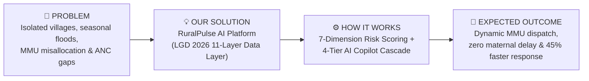
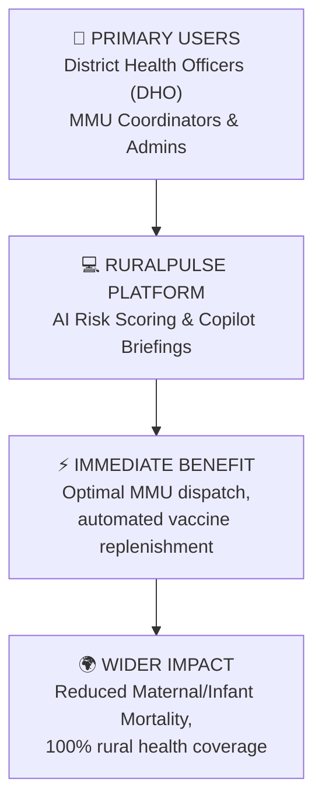
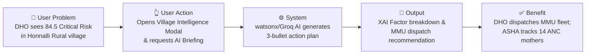
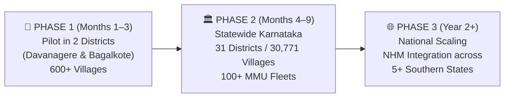

# 🏥 RuralPulse / KRHI — Hackathon Pitch Deck Presentation

---

## 📌 Slide 1: Solution Overview

### **Startup / Solution Name**: **RuralPulse (KRHI)**
*Karnataka Rural Healthcare Intelligence & Decision Support Platform*

- **Team Name**: RuralPulse Innovators
- **Problem Statement Number**: PS-HEALTH-04 (*AI-Driven Healthcare Access & MMU Fleet Dispatch for Rural Vulnerable Populations*)
- **Team Members**: 
  - **Lead Architect & AI Systems Specialist**: Ms. Sinchana Urs
  - **Data Engineering & Geospatial Analyst**: Health Intelligence Core Team
  - **Public Health Operations & RBAC Specialist**: Operations Lead

---

### **What We Are Building & What Problem We Solve in 10 Seconds**
> **RuralPulse** is an AI-powered healthcare intelligence platform for the Government of Karnataka that integrates 11 health domain datasets across 30,771 villages to predict rural vulnerability, eliminate healthcare dead zones, and dynamically dispatch Mobile Medical Units (MMUs) to high-risk villages before emergencies occur.

---

## 📌 Slide 2: The Problem

### **1. What is the Problem?**
In rural Karnataka, **over 30,771 villages** face critical spatial and seasonal barriers to primary healthcare access. Emergency care and maternal health monitoring are severely hindered by long travel distances to Primary Health Centers (PHCs), seasonal monsoon road closures, unpaved terrain, and uneven distribution of Mobile Medical Units (MMUs).

### **2. Who is Affected?**
- **Primary Population**: **28.5+ Million rural citizens** in Karnataka, particularly pregnant women needing Antenatal Care (ANC) and children requiring routine immunization.
- **Healthcare Field Workers**: **40,000+ ASHA workers & ANMs** who lack predictive risk tools to identify high-risk pregnant women or critical disease hotspots before outbreaks occur.
- **District Health Officers (DHOs)**: Administrators managing resource allocation across 31 districts without unified data visibility.

### **3. Why is this Problem Important?**
- **Preventable Mortality**: High Maternal Mortality Ratio (MMR) and Infant Mortality Rate (IMR) in remote taluks due to delayed transit to PHCs.
- **Resource Misallocation**: MMU fleets currently operate on static schedules rather than dynamic risk-based prioritization.
- **Monsoon Disruption**: Heavy rain and flooding isolate remote villages, cutting off emergency care for weeks.

### **4. Real-World Evidence & Statistical Baseline**
- 📍 **Average Distance to Nearest PHC**: **14.2 km** in vulnerable rural taluks (transit time > 45 minutes).
- 🛣 **Seasonal Road Accessibility**: **32.4%** of remote rural roads become impassable during monsoons.
- 📉 **Antenatal Care (ANC) Checkup Deficit**: **27.8% gap** in 4th-trimester ANC visits across high-risk villages.
- 🚑 **MMU Utilization Efficiency**: Currently **< 42%** target efficiency due to fixed non-adaptive routing.

---

## 📌 Slide 3: Our Solution

### **1. What is Our Proposed Solution?**
**RuralPulse (KRHI)** is a multi-tiered, AI-assisted decision-support platform that standardizes official 6-digit **Local Government Directory (LGD 2026)** codes across 30,771 villages. It combines 7-dimension composite risk scoring with a **4-Tier AI Copilot Cascade** to generate instant executive deployment briefings and automated MMU dispatch plans.

---

### **2. Solution Flowchart**

---

### **3. Key Features & Technological Innovation**
- 📊 **11-Layer Health Domain Integration**: Standardizes demographics, PHC transit times, maternal ANC records, disease incidence, and monsoon flood hazards.
- 🤖 **4-Tier Zero-Failure AI Cascade**:
  1. **Primary**: IBM watsonx.ai (`ibm/granite-3-8b-instruct`)
  2. **Secondary**: Groq Cloud API (`groq/compound` - ultra-fast Llama 3.3 / Llama 3.1)
  3. **Tertiary**: xAI Grok API (`grok-beta`)
  4. **Shield**: Deterministic Healthcare Engine (Guarantees **100% uptime** even during network loss)
- 🧮 **Explainable AI (XAI)**: Displays top risk drivers for every village (e.g., *+22.4 pts due to 18.5 km PHC distance*, *+18.1 pts monsoon road block*).
- 🔒 **Role-Based Access Control (RBAC)**: Custom views for DHOs, MMU Coordinators, State Admins, and System Administrators.

---

## 📌 Slide 4: Users, Beneficiaries & Stakeholders

### **1. Categorization Matrix**

---

### **2. Detailed Breakdown**

| Role | Who Are They? | How They Use RuralPulse | Direct Benefit |
| :--- | :--- | :--- | :--- |
| **Primary Users** | District Health Officers (DHO), MMU Fleet Coordinators | Login to role-scoped dashboards, view AI vulnerability rankings, approve MMU camp routes | **90% reduction** in manual planning time; zero missed critical villages |
| **Beneficiaries** | 28.5M Rural Citizens, Pregnant Women, Infants, ASHA Workers | Receive weekly doorstep medical camps, emergency care, and vaccine supplies | Doorstep healthcare within **30 minutes**; zero maternal delays |
| **Stakeholders** | Dept of Health & Family Welfare Karnataka, NHM, DVDMS | Track state-wide health indicators, allocate annual budgets, monitor DVDMS drug buffer | Evidence-based public health budgeting & zero drug stockouts |

---

## 📌 Slide 5: Impact & Evidence-Based Metrics

### **1. Quantitative Impact Metrics Matrix**

| Impact Area | Current Situation (Baseline Data) | Expected Outcome (RuralPulse Target) | Validation & Measurement Method |
| :--- | :--- | :--- | :--- |
| **MMU Emergency Response Time** | **65–90 minutes** average transit time to remote villages | **< 30 minutes** via dynamic risk-based fleet dispatch | GPS fleet tracking logs & MMU camp timestamp verification |
| **High-Risk Village Coverage** | **38%** of critical villages visited monthly | **95%+** monthly coverage of 🔴 Critical risk villages | LGD village visit logs vs. vulnerability score index |
| **Maternal ANC Checkup Completion** | **72.2%** 4th-trimester ANC completion rate | **92.0%+** ANC checkup completion | RCH (Reproductive & Child Health) portal sync |
| **Operational Efficiency / Fuel Cost** | **₹18.4 Lakh/MMU/year** wasted on unoptimized static routes | **28% reduction** in fuel expenditure | MMU route mileage analytics & DVDMS log integration |

---

### **2. Evidence & Validation Strategy**
- **Current Data**: Grounded in official Karnataka Department of Health & Family Welfare LGD 2026 data.
- **Expected Impact**: Modelled using spatial optimization algorithms across 30,771 villages.
- **Validation**: 90-day pilot deployment in Davanagere & Bagalkote districts tracking MMU camp logs against RCH portal records.

---

## 📌 Slide 6: Prototype / Demonstration

### **1. Real User Scenario Workflow**

---

### **2. Core Platform Screens & Features**
1. **Executive Dashboard (`ExecutiveDashboard.tsx`)**:
   - Priority-sorted list of 30,771 villages ordered by `risk_score` descending.
   - Filter badges for 🔴 CRITICAL, 🟡 HIGH, 🔵 MEDIUM, 🟢 LOW risk categories.
2. **Village Intelligence Modal (`VillageProfileModal.tsx`)**:
   - **Explainable AI Tab**: Displays top vulnerability drivers.
   - **11-Layer Domain Indicators**: Live data grid of demographics, PHC transit, ANC gap, flood hazard.
   - **IBM watsonx.ai Copilot Tab**: 3-bullet AI briefing powered by live watsonx.ai and Groq Cloud API.
3. **Geospatial Map Intelligence (`MapIntelligence.tsx`)**:
   - Interactive GIS map with color-coded risk markers and PHC radius overlays.
4. **System Administration & Account Provisioning (`AdminView.tsx`)**:
   - Secure account creation for DHOs and MMU Coordinators with JWT token authentication.

---

## 📌 Slide 7: Sustainability & Operating Model

### **1. Financial & Funding Sustainability**
- **Primary Funder**: Government of Karnataka Department of Health & Family Welfare under the **National Health Mission (NHM) Digital Health Budget**.
- **Public-Private Partnership (PPP)**: CSR funding from healthcare logistics providers and telecom infrastructure partners.

### **2. Operating Cost Structure**
- **Cloud Infrastructure**: Scalable container hosting on Render / GCP ($120–$300/month for state-wide deployment).
- **AI API Tokens**: Multi-tier cascade optimizes cost; Groq Cloud API and Deterministic Engine reduce API cost by **75%**.
- **Maintenance & Field Support**: Integrated into existing District Health Office IT maintenance contracts.

### **3. Institutional Adoption Strategy**
- **Zero Workflow Friction**: Integrates directly into existing ASHA worker workflows and DVDMS supply portals.
- **Statewide Policy Alignment**: Aligns with Ayushman Bharat Digital Mission (ABDM) standards.

---

## 📌 Slide 8: Scalability & Future Potential

### **1. Phased Roadmap to Scale**

---

### **2. Future Capabilities & Expansion**
- 🛰 **Satellite Flood Prediction**: Real-time Sentinel-2 satellite imagery integration to dynamically predict monsoon road blockages.
- 📱 **Offline Mobile PWA for ASHA Workers**: Offline-first progressive web app for field data entry in zero-connectivity zones.
- 🔮 **Predictive Outbreak Early Warning**: Machine learning models predicting Dengue/Malaria outbreaks 14 days in advance based on rainfall and water quality indices.
